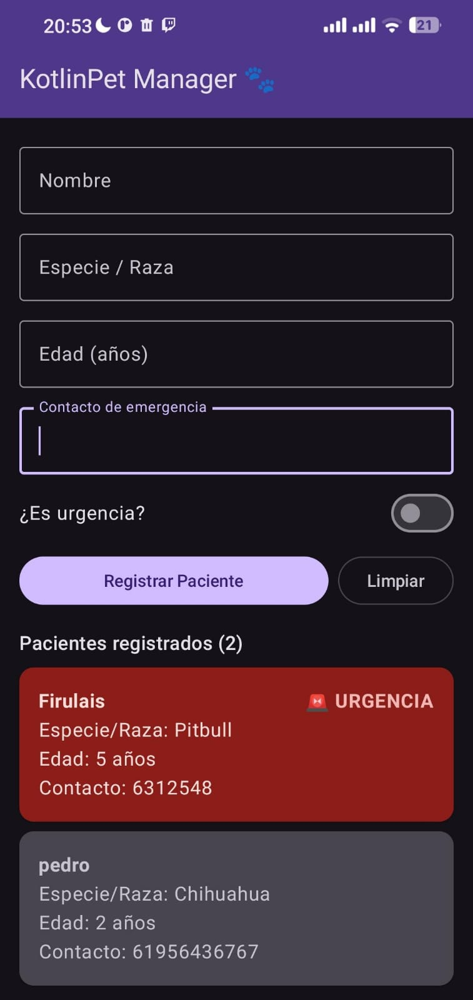

# KotlinPet Manager 🐾

**Estudiante:** Jovani Hernández Osorio
**Código:** 1104674181
**Asignatura:** Desarrollo de Aplicativos Móviles (EE053)

## Descripción
App Android para registrar y visualizar los pacientes de una clínica veterinaria.
Permite ingresar nombre, especie/raza, edad y contacto de emergencia, y marcar si
el paciente es una urgencia. Los pacientes registrados aparecen en una lista dinámica.

Desarrollada con Kotlin, Jetpack Compose, Material 3 y arquitectura MVVM.

## Captura de pantalla
